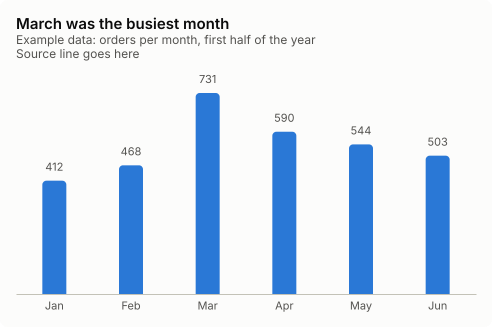
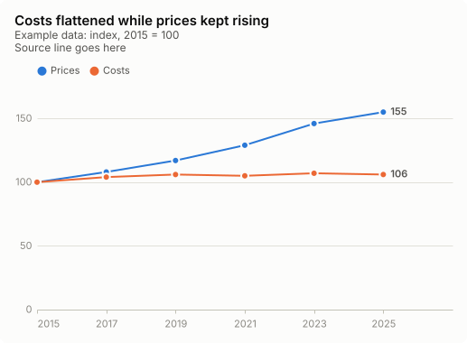

# markdown-charts

A [Claude Code](https://claude.com/claude-code) skill for putting charts in Markdown files.

Claude writes a small Vega-Lite spec. A bundled renderer turns it into an SVG file, which is embedded with a plain image link:

```markdown

```

| Single series | Two series |
|---|---|
|  |  |

## What you get

- **Charts that render everywhere.** SVG image links work in the VS Code Markdown preview, the Office Viewer extension, GitHub, and PDF/DOCX export. No viewer plugin is needed.
- **Light and dark themes.** Every SVG carries a validated, colorblind-checked palette plus a built-in `prefers-color-scheme: dark` variant.
- **Sensible defaults.**
  - Thin marks, hairline grids, and a single axis.
  - A title that states the finding.
  - The data table kept next to each chart.
- **No Python and no native builds.** The skill needs Node.js 18 or later, plus two npm packages (`vega`, `vega-lite`).

## Install

Clone or download this repo, open Claude Code, and say:

> Install the markdown-charts skill by following INSTALL.md in `<path to this folder>`.

Claude will do the following:

1. Copy `markdown-charts/` to `~/.claude/skills/`.
2. Run `npm install`.
3. Render the examples to verify the setup.
4. Add a short note to `~/.claude/CLAUDE.md` so it offers charts in Markdown reports.

See [INSTALL.md](INSTALL.md) for the exact steps if you'd rather do it by hand.

## Use

Ask for a report or notes in Markdown that include numbers. Or ask directly: "add a chart of this table." To render specs yourself:

```sh
node ~/.claude/skills/markdown-charts/render.mjs charts/              # all *.vl.json in the folder
node ~/.claude/skills/markdown-charts/render.mjs charts/my-chart.vl.json
```

Each `my-chart.vl.json` produces `my-chart.svg` next to it. Conventions and troubleshooting are in [markdown-charts/SKILL.md](markdown-charts/SKILL.md).
